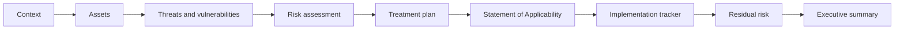

# Cybersecurity Risk Assessment & GRC Case Study

A simulated cybersecurity risk assessment and Governance, Risk and Compliance (GRC) case study based on **ISO/IEC 27001:2022**.

The project shows how an organisation can identify information security risks, evaluate their impact, plan treatment and map controls to an established framework, using a fictional company, **Nexora Solutions Pvt. Ltd.**

---

## Project at a Glance

| Attribute | Details |
|---|---|
| Organisation | Nexora Solutions Pvt. Ltd. (fictional IT services company, 85 employees) |
| Project type | Simulated GRC case study |
| Framework | ISO/IEC 27001:2022 |
| Assets assessed | 10 |
| Threats / vulnerabilities | 9 / 8 |
| Risks assessed | 9 (2 Critical, 6 High, 1 Moderate) |
| Annex A controls reviewed | 93 (23 selected, 55 pending, 14 out of scope, 1 not applicable) |
| Control implementation | 0 of 23 verified (all Proposed — Not Verified) |
| Actual residual risk | Pending implementation and validation |

**Purpose:** to demonstrate practical understanding of risk assessment, risk treatment, control applicability and security governance documentation.

---

## Assessment Workflow

---

## Repository Structure

| File | Description |
|---|---|
| [`01_organisation_profile.md`](01_organisation_profile.md) | Organisation background, roles and assessment scope |
| [`02_asset_inventory.md`](02_asset_inventory.md) | Asset identification, classification and CIA ratings |
| [`03_threat_vulnerability_assessment.md`](03_threat_vulnerability_assessment.md) | Threats, vulnerabilities and their mapping |
| [`04_risk_assessment.md`](04_risk_assessment.md) | Risk scoring, risk register and heat map |
| [`05_risk_treatment_plan.md`](05_risk_treatment_plan.md) | Treatment strategies, Annex A controls and phases |
| [`06_statement_of_applicability.md`](06_statement_of_applicability.md) | Decisions for all 93 Annex A controls |
| [`07_control_implementation_tracker.md`](07_control_implementation_tracker.md) | Owners, priorities, activities and evidence for 23 controls |
| [`08_residual_risk_assessment.md`](08_residual_risk_assessment.md) | Target residual risk and reassessment rules |
| [`09_executive_summary.md`](09_executive_summary.md) | Management-level summary |
| [`10_methodology_and_references.md`](10_methodology_and_references.md) | Methodology, scoring criteria and references |

**Suggested reading order:** start with `09_executive_summary.md`, then follow `01` to `08`. Read `10` for the methodology.

---

## Identified Risks

| ID | Risk | Score | Rating |
|---|---|---|---|
| R01 | Phishing and Account Compromise | 20 | Critical |
| R02 | Ransomware Infection | 20 | Critical |
| R03 | Insider Data Misuse | 15 | High |
| R04 | Cloud Data Exposure | 15 | High |
| R05 | Exploitation of Unpatched Software | 16 | High |
| R06 | DDoS Service Disruption | 9 | Moderate |
| R07 | Hardware Failure and Data Loss | 12 | High |
| R08 | Source Code Compromise | 12 | High |
| R09 | Financial Records Compromise or Tampering | 12 | High |

Each risk is linked to an asset, threats, vulnerabilities, an owner and Annex A controls.

---

## Methodology in Brief

- **Risk Score = Likelihood × Impact**, each on a 1–5 scale.
- Bands: **1–4 Low · 5–9 Moderate · 10–16 High · 17–25 Critical**. These are this project's own criteria, not ISO requirements.
- **Initial risk** is before treatment. **Target residual risk** is a plan. **Actual residual risk** is only assigned after evidence of implementation and effectiveness.

Full details are in [`10_methodology_and_references.md`](10_methodology_and_references.md).

---

## Key GRC Concepts Demonstrated

- Governance, Risk and Compliance (GRC)
- Asset inventory and classification
- Threat and vulnerability analysis
- Likelihood and impact assessment, risk register and heat map
- Risk treatment options and risk acceptance criteria
- ISO/IEC 27001:2022 Annex A control mapping
- Statement of Applicability (all 93 controls)
- Control implementation tracking and evidence requirements
- Residual risk assessment
- Management-level security reporting and traceability

---

## Standards and References

- ISO/IEC 27001:2022 — Information Security Management Systems
- ISO/IEC 27002:2022 — Information Security Controls
- ISO/IEC 27005:2022 — Information Security Risk Management
- ISO 31000:2018 — Risk Management Guidelines
- NIST Cybersecurity Framework 2.0

Official resources: [ISO](https://www.iso.org/) · [NIST Cybersecurity Framework](https://www.nist.gov/cyberframework)

---

## Limitations and Disclaimer

This is an independent educational portfolio project using a fictional organisation.

- Nexora Solutions Pvt. Ltd. is not a real assessed organisation.
- Assets, threats, vulnerabilities and risk scenarios are simulated.
- Risk scores are based on stated assumptions, not measurements.
- No real infrastructure was accessed; no penetration testing or vulnerability scanning was performed.
- 55 Annex A controls are pending full assessment and 14 physical controls are out of scope.
- Third-party and supplier risk is acknowledged but not assessed.
- No control has been verified as implemented.
- This is not an ISO/IEC 27001 certification audit or proof of compliance.

---

## Version History

| Version | Summary |
|---|---|
| 1.0 | Initial case study: 7 risks, 22 selected controls |
| 2.0 | Added R08 and R09 so every asset is covered; full 93-control Statement of Applicability; consistent control mapping across documents; target residual risk; heat maps; formatted tables |

---

## Author

**Neelkumar Nileshbhai Shrimali**
Cybersecurity | Governance, Risk & Compliance | Information Security

- GitHub: [neel-sh11](https://github.com/neel-sh11)
- LinkedIn: Neel Shrimali
- Email: framebyneels@gmail.com

---

*This repository is part of an independent cybersecurity learning and portfolio development journey.*
