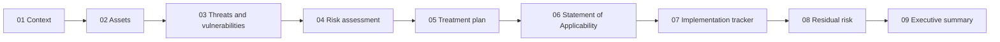

# 10 — Methodology and References

| Field | Details |
|---|---|
| Organisation | Nexora Solutions Pvt. Ltd. (fictional) |
| Document | 10 — Methodology and References |
| Framework | ISO/IEC 27001:2022 |
| Version | 2.0 |
| Status | Final — Methodology Documentation |

---

## 1. Introduction

This document explains the methodology, scoring criteria, terminology and references used across the Nexora Solutions risk assessment. The project is educational and portfolio-based. It is not a certification audit or an assessment of a real organisation.

---

## 2. Assessment Workflow

| Step | Document | Output |
|---|---|---|
| Organisational context | `01_organisation_profile.md` | Scope, roles, assumptions |
| Asset identification | `02_asset_inventory.md` | 10 assets with classification and CIA ratings |
| Threats and vulnerabilities | `03_threat_vulnerability_assessment.md` | 9 threats, 8 vulnerabilities |
| Risk assessment | `04_risk_assessment.md` | 9 rated risks, register, heat map |
| Risk treatment | `05_risk_treatment_plan.md` | Strategies and control mapping |
| Statement of Applicability | `06_statement_of_applicability.md` | Decisions for all 93 Annex A controls |
| Implementation tracking | `07_control_implementation_tracker.md` | 23 controls with owners and evidence needs |
| Residual risk | `08_residual_risk_assessment.md` | Target levels and reassessment rules |
| Executive reporting | `09_executive_summary.md` | Management summary |

---

## 3. Traceability

Each risk can be traced through the whole chain:

**Asset → Threat → Vulnerability → Risk → Treatment → Annex A control → Tracker entry → Residual risk**

Example: A05 Corporate Email → T01 Phishing and T06 Credential theft → V01, V02, V03 → R01 → MFA, email and web filtering, training → A.5.17, A.6.3, A.8.5, A.8.7, A.8.16, A.8.23 → tracker entries → R01 target residual.

---

## 4. Terminology

| Term | Meaning in this project |
|---|---|
| Asset | Information or a resource that has value to the organisation |
| Threat | A potential cause of harm |
| Vulnerability | A weakness that a threat could exploit |
| Risk | The combination of likelihood and impact of a threat exploiting a vulnerability |
| Initial risk | Risk before proposed treatment; no existing control is assumed to be verified |
| Target residual risk | Planned risk level if the proposed controls are implemented and effective |
| Actual residual risk | Risk measured after implementation and effectiveness testing |
| Risk owner | Person accountable for managing a risk |

---

## 5. Risk Scoring

**Risk Score = Likelihood × Impact**, both on a five-point scale.

### Likelihood

| Score | Rating | Description |
|---|---|---|
| 1 | Rare | Highly unlikely to occur |
| 2 | Unlikely | Could occur, but not expected |
| 3 | Possible | May occur under certain circumstances |
| 4 | Likely | Expected to occur in relevant circumstances |
| 5 | Almost certain | Expected to occur frequently |

### Impact

| Score | Rating | Description |
|---|---|---|
| 1 | Insignificant | Minimal operational or information impact |
| 2 | Minor | Limited disruption or loss |
| 3 | Moderate | Noticeable operational or information impact |
| 4 | Major | Significant business disruption or information compromise |
| 5 | Severe | Critical business, financial, legal or reputational consequences |

### Rating bands

| Score | Rating | Treatment priority |
|---|---|---|
| 1–4 | Low | Routine monitoring |
| 5–9 | Moderate | Planned improvement |
| 10–16 | High | Priority treatment |
| 17–25 | Critical | Immediate attention |

These bands are the project's own criteria, not thresholds prescribed by ISO/IEC 27001.

---

## 6. Risk Acceptance Criteria (Illustrative Risk Appetite)

| Residual rating | Required action | Approver |
|---|---|---|
| Low | Accept with routine monitoring | Risk owner |
| Moderate | Accept with documented periodic review | Risk owner |
| High | Further treatment, or formal acceptance with justification | Senior Management |
| Critical | Not acceptable; further treatment required | Senior Management |

Stated aim: reduce all risks to Moderate or below, with any High residual risk formally approved.

---

## 7. Risk Treatment and Control Selection

Treatment options: **avoid**, **mitigate**, **transfer or share**, **accept**. This project mainly proposes mitigation.

Control selection considers:

1. The nature of the risk and the assets affected
2. Likelihood and impact
3. The chosen treatment strategy
4. Relevance of ISO/IEC 27001:2022 Annex A controls
5. The evidence needed to show implementation

A selected control is not an implemented control.

---

## 8. Statement of Applicability Approach

All 93 Annex A controls are listed in `06` with one of four decisions: **Selected**, **Pending**, **Out of scope** or **Not applicable**. The decision counts are 23, 55, 14 and 1.

---

## 9. Control Implementation Status Definitions

| Status | Meaning |
|---|---|
| Proposed — Not Verified | Selected; implementation not established by evidence |
| In Progress | Implementation started but incomplete |
| Implemented — Pending Verification | Reported as deployed; effectiveness not verified |
| Partially Implemented | Some requirements met; gaps remain |
| Verified | Implementation and effectiveness assessed with evidence |

The baseline for all 23 selected controls is **Proposed — Not Verified**.

---

## 10. Residual Risk Evaluation

After treatment, evaluation should consider:

- Whether each control is implemented and supported by evidence
- Whether it operates as intended
- Whether likelihood or impact has changed
- Whether further treatment is needed
- Whether the remaining risk is within acceptance criteria

Residual scores are recalculated with the same method as the initial assessment. Targets in `08` are planning aims, not results.

---

## 11. Assumptions and Limitations

1. Nexora Solutions Pvt. Ltd. is fictional and the environment is simulated.
2. Assets, threats, vulnerabilities and risk scenarios are illustrative.
3. Ratings are based on stated assumptions, not measurements.
4. No real systems were accessed, scanned or tested.
5. 23 Annex A controls are selected; 55 are pending assessment and 14 physical controls are out of scope.
6. Third-party and supplier risk is acknowledged but not assessed.
7. No implementation evidence has been supplied or verified.
8. Actual residual risk is pending.

---

## 12. References

1. ISO/IEC 27001:2022 — Information security, cybersecurity and privacy protection — Information security management systems — Requirements
2. ISO/IEC 27002:2022 — Information security controls
3. ISO/IEC 27005:2022 — Guidance on managing information security risks
4. ISO 31000:2018 — Risk management — Guidelines
5. NIST Cybersecurity Framework 2.0

Official resources:

- ISO: https://www.iso.org/
- NIST Cybersecurity Framework: https://www.nist.gov/cyberframework

This project draws on the general principles of these references. It does not claim conformity or certification.

---

## 13. Conclusion

The methodology links context, assets, threats, risk evaluation, treatment, control selection and residual risk planning in one traceable chain, and keeps proposed improvements separate from verified implementation.

---

**Project:** Cybersecurity Risk Assessment & ISO 27001 Case Study
**Document:** 10 — Methodology and References
